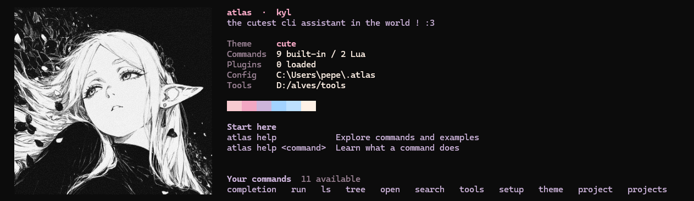

<div align="center">

<h1 style="font-size:3rem; letter-spacing:2px;">Atlas</h1>

<hr width="60%">

<p><strong>Atlas</strong> is a fast, Windows-native command-line toolkit for personal automation.<br>
Built with C++23, Lua 5.4 and sol2.</p>

<pre>
	Search. Launch. Organize.
</pre>

</div>

<p align="center">
  
</p>

## Quick start

```powershell
atlas --help
atlas search <query>
atlas open .
```

Everything, themes, Lua commands and shell completion live behind one small CLI.

If you want to see what it can do, read the [docs](docs/README.md).
